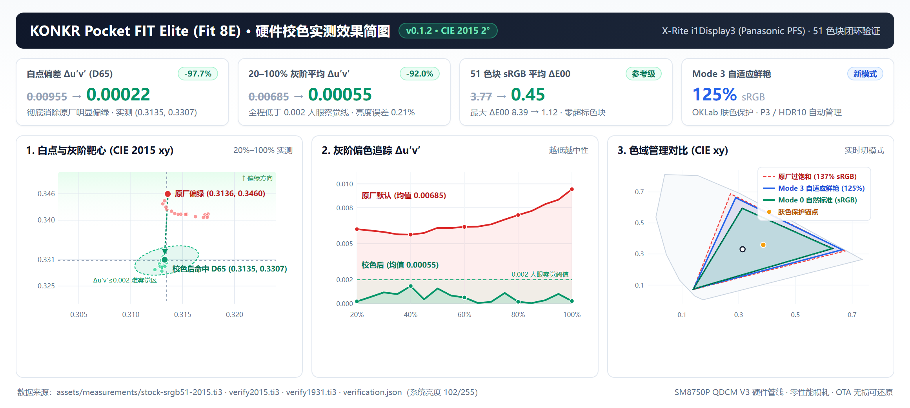

**本项目由 GPT6.2 Astra 和 Gemini4 Neon 构建。**

# Fit 8E 屏幕校色工具

为 KONKR Pocket FIT Elite（Fit 8E）的内屏安装原生硬件校色档（支持电脑 USB 工具或掌机内置 AYASettings Root 脚本免电脑安装），改善原厂过饱和与白点偏绿。当前版本为 **0.1.2**。[English](README_EN.md) · [更新记录](CHANGELOG.md) · [项目主页](https://github.com/lx081081/Fit8E-ColorCalib)

应用代码采用 GNU 通用公共许可证第 3 版（仅此版本）。[许可证全文](LICENSE) · [第三方声明](THIRD_PARTY_NOTICES.md)

## 使用前请注意

- **仅适用于骁龙 8 Elite、配备 ar14 内屏的 Fit 8E。** 若工具提示「面板待确认」，请先核实内屏型号，再勾选手动确认。Fit 8G3 和其他掌机请勿安装。
- **安装或卸载前请保存游戏进度。** Windows 工具默认会重启掌机，掌机端 Root 脚本安装/卸载后会提示手动重启。使用过旧版自定义档的用户，请保留当时安装的 JSON，以便卸载时核对。
- 这是社区工具，修改显示配置的风险由使用者承担。内置档来自一台样机，同型号面板之间也有差异。

## 功能

- **白点色温**支持 5500–7500 K。滑块和 6000 / 6500 / 6800 / 7100 K 四个预设均按 CIE 2015 2° 观察者计算。点击预设会将色调归零。手动移动色温滑块会保留色调。
- **6500 K、色调 0** 直接使用本机实测并复核的 D65 原档。其余设置会生成新的校色表，可导出 JSON、导出单文件 **AYASettings Root 脚本（`.sh`）** 或直接通过 USB 安装。选中自定义 JSON 后，工具使用文件内的白点，锁定两个滑块（仍可导出为 Root 脚本）。
- **自然标准**按内容使用 sRGB、Display P3 或 HDR10。**增强模式**提高饱和度，**鲜艳模式**使用面板原生广色域，**自适应鲜艳（Mode 3）**在保持 CIE 2015 2° 白点与肤色保护的前提下提升 sRGB 鲜艳度，并保留 Display P3 与 HDR10 自动切换。

## 使用步骤

### 方式一：电脑 USB 连接（支持自定义色温与实时预览）

1. 完整解压 `Fit8E-ColorCalib-v0.1.2-win64.zip`，双击 `Fit8E-ColorCalib.exe`。便携包已包含 ADB、默认校色档和掌机端预设 Root 脚本。公开发布的版本可在[发布页](https://github.com/lx081081/Fit8E-ColorCalib/releases)查看。
2. 在掌机的开发者选项开启 **USB 调试**。用数据线连接电脑，允许调试，点工具的「刷新」，确认型号为 `Pocket FIT Elite`。
3. 首次使用可保留 **6500 K、色调 0**。点「一键安装校色并重启」，或点「仅安装（稍后重启）」自行选择重启时间。
4. 重启后解锁并刷新。若 Windows 未重新识别掌机，重插掌机数据线并选择「文件传输」。旧版安装缺少重启记录时会显示「生效待确认」。
5. 需要撤销时，点「卸载并还原原厂」。工具恢复首次安装前的配置和显示模式，并识别历史内置 6500 K 档。遇到锁占用或传输超时，请先等当前操作结束，再刷新核对档案。

### 方式二：掌机免电脑安装（AYASettings「Root 脚本」）

无需电脑、无需开启 USB 调试、无需 Shizuku，可直接通过掌机内置的 **AYASettings → Root 脚本** 执行单文件自包含 `.sh` 脚本（含完整机型 / `ar14` 面板校验、SHA-256 核对、原厂备份和 SELinux 标签，与电脑版工具完全互通）：

1. 从[发布页](https://github.com/lx081081/Fit8E-ColorCalib/releases)下载独立的 `Fit8E-ColorCalib-v0.1.2-root-scripts.zip`（Windows 便携包内 `root-scripts/` 目录也包含相同脚本），解压到掌机内部存储（推荐 `/sdcard/Download/Fit8E/`；**注意目录路径和文件名不要包含空格**）。
2. 打开掌机内置 **AYASettings → Root 脚本**，选择想要的色温预设安装脚本：
   - `01_Fit8E_安装校色_6500K_D65标准.sh`（CIE 2015 2° 实测 D65 标准，推荐）
   - `02_Fit8E_安装校色_6000K_暖色.sh`（6000 K 暖色日光）
   - `03_Fit8E_安装校色_6800K_微冷.sh`（6800 K 微冷清透）
   - `04_Fit8E_安装校色_7100K_冷白.sh`（7100 K 冷白通透）
3. 务必点击 **「整体运行」**（不要点击「逐行运行」；误点时会提示改用整体运行并安全退出，不会修改系统）。等待结果弹窗提示 **「安装成功」** 后，**手动重启掌机**即可生效。
4. 重启激活后，可在「Root 脚本」中随时**整体运行**以下脚本实时切换色彩模式（无需再次重启）：
   - `10_Fit8E_切换模式0_自然标准.sh` · `11_Fit8E_切换模式3_自适应鲜艳.sh` · `12_Fit8E_切换模式1_增强模式.sh` · `13_Fit8E_切换模式2_鲜艳模式.sh`
5. 运行 `20_Fit8E_查看当前状态.sh` 可查看当前摘要、激活状态与模式；运行 `99_Fit8E_卸载还原原厂.sh` 可恢复首次安装前的原厂配置（完成后**手动重启掌机**）。
6. 如需自定义 5500–7500 K 色温、红绿微调或个人测量 JSON，可在电脑版点击 **「导出 Root 脚本」** 生成单文件 `.sh`（小于 250 KB，符合 AYASettings 1 MB 文件限制）拷入掌机运行。

macOS、Linux、命令行和 Shizuku

- macOS / Linux 需要 Python 3.9 或以上版本及 ADB。在源码目录运行 `python3 src/fit8e_color_tool.py status`。确认 `Target Match` 为 `True` 后，运行 `python3 src/fit8e_color_tool.py install` 安装默认档。
- 导出自定义 JSON：`python3 src/fit8e_color_tool.py export --cct 6800 --tint 0 --out fit8e-6800.json`。有自己的测量时，可用 `src/build_qdcm_v3.py` 将常规 1931 RGB/XYZ 格式的 ArgyllCMS `.ti3` 生成为自定义档。
- 导出单文件 AYASettings Root 脚本：`python3 src/fit8e_color_tool.py export-script --cct 6800 --tint -1 --out Fit8E_6800K.sh`（支持 `--json <自定义JSON>`、`--action mode --mode 3`、`--action status`、`--action uninstall`）；批量导出全部预设脚本包：`python3 src/fit8e_color_tool.py export-presets --out-dir ./root-scripts`。
- 掌机端使用 Shizuku 时，将 `scripts/fit8e_calib_shizuku.sh` 和 `assets` 中的默认校色 JSON 放到 `/sdcard/Download/`。在已授权的终端运行 `sh /sdcard/Download/fit8e_calib_shizuku.sh install`，成功后手动重启。

## 工作原理与实测

色温数值表示 CIE D 系列日光的标称色温。工具以 1 nm 间隔积分日光基函数和 2015 2° 观察者函数，以标准 D65 光谱为 6500 K 锚点。色调沿该观察者的日光轨迹向绿色或品红微调。程序用样机的两组 105 色测量换算 sRGB 和 Display P3 原色，再用实测灰阶生成硬件查找表。[CIE 日光基函数](https://doi.org/10.25039/CIE.DS.w7zunnny) · [CIE 2015 2° 观察者](https://doi.org/10.25039/CIE.DS.548rw69q)

在自然模式、系统亮度 102/255 下，默认档的 51 色复测得到以下结果。仪器为 X-Rite i1Display3，使用松下 PFS 校正光谱。

| 指标 | 原厂默认 | 0.1.2 默认档 (Mode 0) |
|---|---:|---:|
| 白点到 2015 D65 的距离 Δu′v′ | 0.00955 | 0.00022 |
| 20%–100% 灰阶平均 Δu′v′ | 0.00685 | 0.00055 |
| 白场亮度（cd/m²，同一亮度设置） | 211.96 | 191.20 |

校准后五次白点测量的平均坐标为 **(0.31345, 0.33072)**，D65 目标为 **(0.31345, 0.33080)**。在 1931 2° 下按适配后的 sRGB 目标复核，51 色平均 ΔE00 为 **0.45**，最大 **1.12**（0.1.2 的 Mode 0 sRGB 硬件表与 0.1.1 实测档一致；新增的 Mode 3 自适应鲜艳与 Mode 0 共用逐点一致的中性灰轴，并在 OKLab 空间执行肤色保护与约 125% sRGB 平滑广色域扩展）。其他色温是模型计算值。HDR10 继续使用 PQ 映射，280 尼特拐点、447 尼特目标峰值和 0.37 尼特黑位均为档案参数。本轮光学复测档案覆盖自然模式的 SDR sRGB。[本轮测量数据](assets/measurements/verification.json)
