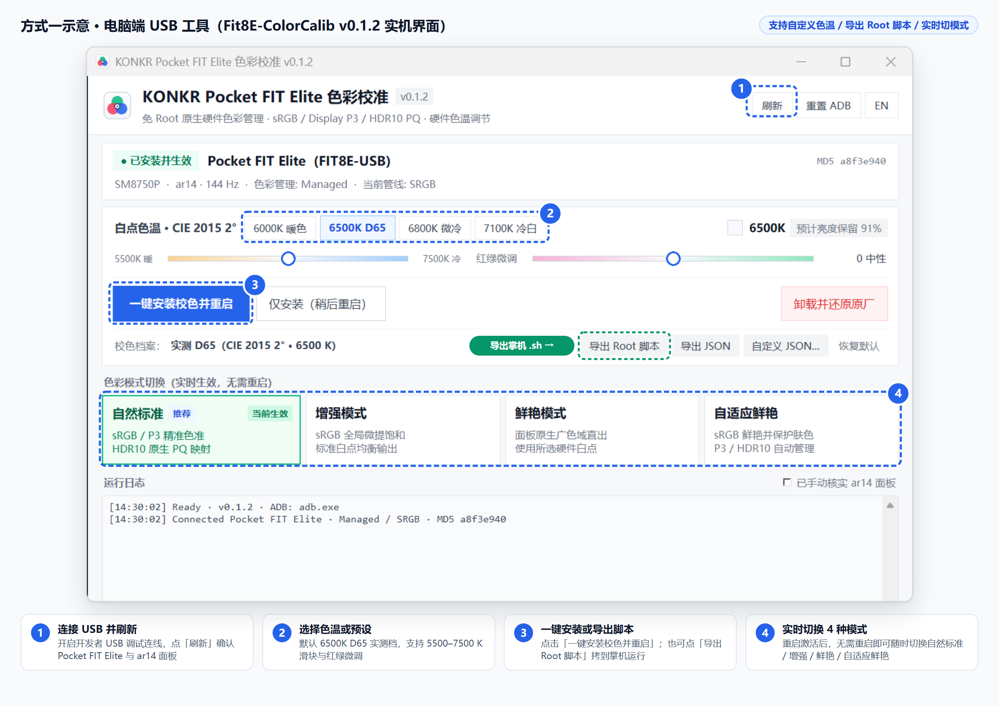
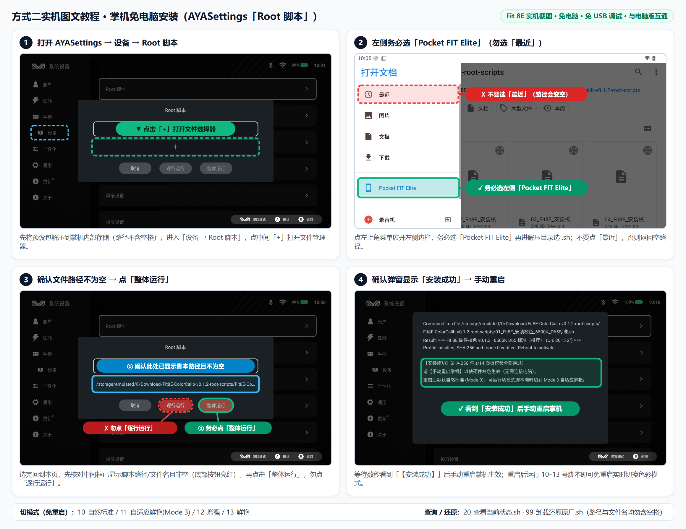

**本项目由 GPT6.2 Astra 和 Gemini4 Neon 构建。**

# Fit 8E 屏幕校色工具

为 **KONKR Pocket FIT Elite（Fit 8E）** 内屏安装高通 SM8750P 原生 QDCM 硬件校色档，彻底改善原厂过饱和与白点偏绿问题；支持电脑 USB 一键安装，也支持掌机内置 AYASettings「Root 脚本」免电脑安装。当前版本为 **0.1.2**。[English](README_EN.md) · [更新记录](CHANGELOG.md) · [项目主页](https://github.com/lx081081/Fit8E-ColorCalib)

应用代码采用 GNU 通用公共许可证第 3 版（仅此版本）。[许可证全文](LICENSE) · [第三方声明](THIRD_PARTY_NOTICES.md)

## 使用须知

- **仅适用于骁龙 8 Elite、配备 `ar14` 内屏的 Fit 8E。** 若工具提示「面板待确认」，请先核实内屏型号后再勾选手动确认。Fit 8G3 及其他机型请勿安装。
- **安装或卸载前请先保存游戏进度。** Windows 工具默认会在操作完成后自动重启掌机；掌机端 Root 脚本则会提示手动重启。曾使用旧版自定义档的用户，请妥善保留当时安装的 JSON 以便卸载核对。
- 本项目为社区开源工具，修改显示配置的风险由使用者自行承担。内置基准档测自一台样机，不同批次面板个体之间可能存在细微差异。

## 软件功能

- **原生硬件校色，零性能损耗**：写入 SM8750P 底层 QDCM V3 显示管线（3D LUT + IGC/GC），免 Root、不修改系统分区、OTA 无损，并自动留存首次安装前的状态以便随时一键还原。
- **CIE 2015 2° 色温与红绿微调**：支持 **5500–7500 K** 连续色温滑块、**6000 / 6500 / 6800 / 7100 K** 四个快捷预设以及 **-10..+10** 红绿色调微调，统一基于 CIE 2015 2° 观察者模型计算。点击预设会将色调归零，手动移动色温滑块则保留当前色调。
- **实测基准档与多形式导出**：**6500 K、色调 0** 直接使用本机实测并复核的 D65 原档；其余组合会实时编译新的硬件校色表，支持 **USB 直接安装**、**导出 JSON** 或 **导出单文件 AYASettings Root 脚本（`.sh`）**。选中外部自定义 JSON 后，工具会保留文件内白点并锁定滑块（仍可封装导出为 Root 脚本）。
- **四档原生色彩模式实时切换（免重启）**：
  - **自然标准（Mode 0，推荐）**：按内容自动切换 sRGB、Display P3 与 HDR10 PQ，严格忠实还原标准色准。
  - **增强模式（Mode 1）**：基于精准 sRGB 基线施加系统原生轻度饱和度增益，观感更通透均衡。
  - **鲜艳模式（Mode 2）**：开放面板原生广色域直出，同时保持校准后的目标白点与灰阶。
  - **自适应鲜艳（Mode 3）**：在锁定 CIE 2015 2° 白点与 OKLab 肤色保护的前提下平滑扩展 sRGB 鲜艳度（约 125% sRGB），并继续保留 Display P3 与 HDR10 自动管理。

## 使用说明

### 方式一：电脑 USB 连接（支持自定义色温与实时预览）

1. 前往[发布页](https://github.com/lx081081/Fit8E-ColorCalib/releases)下载并完整解压 `Fit8E-ColorCalib-v0.1.2-win64.zip`，双击运行 `Fit8E-ColorCalib.exe`（便携包已内置 ADB、默认校色档与全套掌机端预设 Root 脚本）。
2. 在掌机「开发者选项」中开启 **USB 调试**，用数据线连接电脑并在掌机端点击允许调试；回到工具点击 **「刷新」**，确认识别为 `Pocket FIT Elite`。
3. 首次使用建议保持默认的 **6500 K、色调 0**，点击 **「一键安装校色并重启」**（或点「仅安装（稍后重启）」自行安排重启）。
4. 重启解锁后再次点击刷新确认已生效。若 Windows 未重新识别掌机，重插数据线并将 USB 用途切换为「文件传输」即可；缺少重启记录的旧版安装会显示「生效待确认」。
5. 如需还原，点击 **「卸载并还原原厂」** 即可自动恢复首次安装前的配置与显示模式（兼容历史 0.1.0 / 0.1.1 内置 6500 K 档）。若遇到锁占用或传输超时提示，请等待当前操作结束后刷新核对。

### 方式二：掌机免电脑安装（AYASettings「Root 脚本」）

无需电脑、无需开启 USB 调试、无需 Shizuku，直接通过掌机内置的 **AYASettings → 设备 → Root 脚本** 运行单文件自包含 `.sh` 脚本即可完成安装（内置完整机型 / `ar14` 面板校验、SHA-256 核对、原厂备份和 SELinux 标签，与电脑版工具状态完全互通）：

1. 前往[发布页](https://github.com/lx081081/Fit8E-ColorCalib/releases)下载独立的 `Fit8E-ColorCalib-v0.1.2-root-scripts.zip`（Windows 便携包内的 `root-scripts/` 目录也包含相同脚本），解压到掌机内部存储（推荐 `/sdcard/Download/Fit8E/`；**注意目录路径和文件名均不要包含空格**）。
2. 打开掌机内置 **AYASettings → 设备 → Root 脚本**，点击中间的 **「+」** 打开系统文件选择器。
3. **展开左侧边栏选择「Pocket FIT Elite」（不要选「最近」）**：由于 Fit 8E 系统文件管理器从「最近」选择文件时会返回无法解析的空路径，请先点击左上角菜单图标展开左侧边栏，**务必选择左侧的「Pocket FIT Elite」**，再依次进入解压目录选择所需的色温预设脚本：
   - `01_Fit8E_安装校色_6500K_D65标准.sh`（CIE 2015 2° 实测 D65 标准，推荐）
   - `02_Fit8E_安装校色_6000K_暖色.sh`（6000 K 暖色日光）
   - `03_Fit8E_安装校色_6800K_微冷.sh`（6800 K 微冷清透）
   - `04_Fit8E_安装校色_7100K_冷白.sh`（7100 K 冷白通透）
4. **确认脚本页面文件名称不为空后，点击「整体运行」**：选完路径返回「Root 脚本」弹窗后，**请先确认输入框中已显示脚本路径/文件名称且不为空**（此时底部运行按钮会亮红可点），随后务必点击 **「整体运行」**（不要点击「逐行运行」；误点时会提示改用整体运行并安全退出，不会修改系统）。等待结果弹窗提示 **「安装成功」** 后，**手动重启掌机**即可生效。
5. 重启激活后，按同样步骤在「Root 脚本」中随时**整体运行**以下脚本即可实时切换色彩模式（无需重启）：
   - `10_Fit8E_切换模式0_自然标准.sh` · `11_Fit8E_切换模式3_自适应鲜艳.sh` · `12_Fit8E_切换模式1_增强模式.sh` · `13_Fit8E_切换模式2_鲜艳模式.sh`
6. 运行 `20_Fit8E_查看当前状态.sh` 可查看当前摘要、激活状态与模式；运行 `99_Fit8E_卸载还原原厂.sh` 可完整恢复首次安装前的原厂配置（完成后**手动重启掌机**）。
7. 如需自定义 5500–7500 K 色温、红绿微调或个人测量 JSON，可在电脑版点击 **「导出 Root 脚本」** 生成单文件 `.sh`（小于 250 KB，符合 AYASettings 1 MB 文件限制）拷入掌机运行。

### 可选搭配：[Fit 调色盘（Fit Palette）](https://github.com/lx081081/Fit-Palette) 掌机端实时微调

安装完本工具的底层硬件校色档后，如果希望直接在掌机上**免电脑、零重启**随时微调色彩或一键切模式，推荐搭配安装开源伴侣应用 **[Fit 调色盘（Fit Palette）](https://github.com/lx081081/Fit-Palette)**（约 50 KB、无联网权限、Fit 8E 安装即用）：

- **职责互补**：本工具（Fit8E-ColorCalib）负责底层 QDCM 硬件校色，解决原厂过饱和、偏绿、灰阶 Gamma 与 HDR10 映射；**Fit 调色盘**在其基础上通过高通 DPU 硬件矩阵（`SurfaceFlinger 1015 / 1022`）提供**实时免重启**微调。
- **实时调色与一键切模式**：支持掌机端拖动即见的 **5000–8500 K** CIE 2015 2° 色温、**-10..+10** 红绿微调、**RGB 三通道增益** 与 **0%–150% 全局饱和度**，并可**一键切换本工具的四档硬件色彩模式**（自然标准 / 增强 / 鲜艳 / 自适应鲜艳），无需反复打开 AYASettings 跑脚本，同时支持按需开启开机自动恢复。
- **获取方式**：前往 [Fit-Palette 发布页](https://github.com/lx081081/Fit-Palette/releases) 下载安装 APK 即可；打开后会自动探测本工具的校色档生效状态。

macOS、Linux、命令行和 Shizuku

- **macOS / Linux**：需安装 Python 3.9 及以上版本与 ADB。在源码目录运行 `python3 src/fit8e_color_tool.py status`，确认 `Target Match` 为 `True` 后运行 `python3 src/fit8e_color_tool.py install` 安装默认档。
- **导出自定义 JSON / 个人测量编译**：运行 `python3 src/fit8e_color_tool.py export --cct 6800 --tint 0 --out fit8e-6800.json`；若有个人仪器测得的常规 1931 RGB/XYZ 格式 ArgyllCMS `.ti3` 文件，可用 `src/build_qdcm_v3.py` 编译为专属校色档。
- **命令行导出 Root 脚本**：运行 `python3 src/fit8e_color_tool.py export-script --cct 6800 --tint -1 --out Fit8E_6800K.sh`（支持 `--json <自定义JSON>`、`--action mode --mode 3`、`--action status`、`--action uninstall`）；批量生成全套预设脚本包可运行 `python3 src/fit8e_color_tool.py export-presets --out-dir ./root-scripts`。
- **Shizuku 终端**：将 `scripts/fit8e_calib_shizuku.sh` 与 `assets/` 中的默认校色 JSON 放入 `/sdcard/Download/`，在已授权的终端执行 `sh /sdcard/Download/fit8e_calib_shizuku.sh install`，成功后手动重启。

## 工作原理与实测

色温数值表示 CIE D 系列日光的标称色温。工具以 1 nm 间隔积分日光基函数与 CIE 2015 2° 观察者函数，以标准 D65 光谱为 6500 K 锚点，色调则沿该观察者的均匀色品轨迹向绿色或品红微调。程序依据样机的两组 105 色实测换算 sRGB 和 Display P3 原色矩阵，并结合实测灰阶生成硬件查找表。[CIE 日光基函数](https://doi.org/10.25039/CIE.DS.w7zunnny) · [CIE 2015 2° 观察者](https://doi.org/10.25039/CIE.DS.548rw69q)

在自然标准模式、系统亮度 102/255 下，使用 X-Rite i1Display3（松下 PFS 校正光谱）对默认档执行 51 色闭环复测结果如下：

| 指标 | 原厂默认 | 0.1.2 默认档 (Mode 0) |
|---|---:|---:|
| 白点到 2015 D65 的距离 Δu′v′ | 0.00955 | 0.00022 |
| 20%–100% 灰阶平均 Δu′v′ | 0.00685 | 0.00055 |
| 白场亮度（cd/m²，同一亮度设置） | 211.96 | 191.20 |

校准后五次白点重复测量的平均坐标为 **(0.31345, 0.33072)**，D65 目标为 **(0.31345, 0.33080)**；在 1931 2° 下按适配后的 sRGB 目标复核，51 色平均 ΔE00 为 **0.45**，最大 **1.12**（0.1.2 的 Mode 0 sRGB 硬件表与 0.1.1 实测档一致；新增的 Mode 3 自适应鲜艳与 Mode 0 共用逐点一致的中性灰轴，并在 OKLab 空间执行肤色保护与约 125% sRGB 平滑广色域扩展）。其他色温由实测面板模型计算得出。HDR10 沿用 PQ 映射，280 尼特拐点、447 尼特目标峰值与 0.37 尼特黑位均为档案参数。归档的光学复测数据覆盖自然模式的 SDR sRGB。[本轮测量数据](assets/measurements/verification.json)
