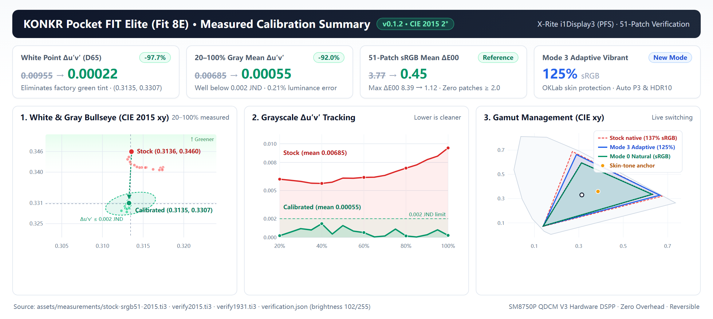
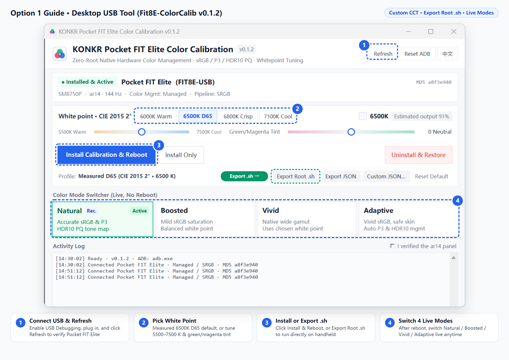

**This project was built by GPT6.2 Astra and Gemini4 Neon.**

# Fit 8E Display Calibration

Install a native hardware color profile on the KONKR Pocket FIT Elite (Fit 8E) via the desktop USB tool or PC-free AYASettings Root Scripts to correct oversaturation and white-point green tint. Current version **0.1.2**. [简体中文](README.md) · [Changelog](CHANGELOG.md) · [Project](https://github.com/lx081081/Fit8E-ColorCalib)

The application code is licensed under the GNU General Public License, version 3 only. [License](LICENSE) · [Third-party notices](THIRD_PARTY_NOTICES.md)

## Before you start

- **Use only on the Snapdragon 8 Elite Fit 8E with its ar14 internal panel.** For a “Panel unconfirmed” result, check the panel model before selecting manual confirmation. Other handhelds, including the Fit 8G3, are unsupported.
- **Save your game before installing or uninstalling.** The Windows tool reboots the handheld by default, while handheld Root Scripts prompt you to reboot manually. Keep any custom JSON used with a legacy installer so the tool can verify it during removal.
- This community tool changes the display configuration at your own risk. The built-in calibration was measured on one unit. Individual panels can vary.

## Features

- The 5500–7500 K slider and the 6000, 6500, 6800 and 7100 K presets use the **CIE 2015 2° observer**. Selecting a preset resets tint to zero. Moving the temperature slider keeps the selected tint.
- **6500 K with tint 0** uses the exact measured D65 profile. Other settings compile new hardware tables for JSON export, single-file **AYASettings Root Script (`.sh`)** export, or direct USB installation. When a custom JSON is selected, the tool uses its white point and locks both sliders (Root Script export remains available).
- **Natural** selects sRGB, Display P3 or HDR10 according to content. **Boosted** increases saturation. **Vivid** uses the native panel gamut. **Adaptive (Mode 3)** enhances sRGB vibrancy with skin-tone protection under the CIE 2015 2° white point while keeping automatic Display P3 and HDR10 management active.

## Getting started

### Option 1: PC via USB (Recommended for custom white points)

1. Extract the complete `Fit8E-ColorCalib-v0.1.2-win64.zip` and launch `Fit8E-ColorCalib.exe`. ADB, the default profile, and preset handheld Root Scripts are included. Public builds are available on the [releases page](https://github.com/lx081081/Fit8E-ColorCalib/releases).
2. Enable **USB debugging** under Developer options. Connect a USB data cable, allow debugging, click **Refresh** and confirm `Pocket FIT Elite`.
3. For the measured default, leave **6500 K and tint 0** selected. Choose **Install Calibration & Reboot** or **Install Only** to reboot later.
4. Unlock the handheld after reboot and refresh. If Windows loses the USB connection, reconnect the data cable and select File transfer. Older installations without a boot record are shown as **Activation Unconfirmed**.
5. Choose **Uninstall & Restore** to restore the recorded configuration and display mode. The tool recognizes the old built-in 6500 K profile. After a busy or timeout message, wait for the operation to finish and refresh before retrying.

### Option 2: Handheld-only via AYASettings "Root Script" (No PC required)

No PC, USB debugging, or Shizuku is needed. Each self-contained `.sh` script runs through the built-in **AYASettings → Root Script** menu with full device/`ar14` panel checks, SHA-256 verification, factory backup, and SELinux labeling, and shares the same state record as the desktop app:

1. Download the standalone `Fit8E-ColorCalib-v0.1.2-root-scripts.zip` from the [releases page](https://github.com/lx081081/Fit8E-ColorCalib/releases) (also bundled under `root-scripts/` in the Windows portable ZIP) and extract it to internal storage such as `/sdcard/Download/Fit8E/` (**do not put spaces in the folder path or filename**).
2. Open **AYASettings → Root Script** on the handheld and pick a preset install script:
   - `01_Fit8E_安装校色_6500K_D65标准.sh` (Measured CIE 2015 2° D65 reference, recommended)
   - `02_Fit8E_安装校色_6000K_暖色.sh` (6000 K warm daylight)
   - `03_Fit8E_安装校色_6800K_微冷.sh` (6800 K crisp white)
   - `04_Fit8E_安装校色_7100K_冷白.sh` (7100 K cool white)
3. Tap **Run File (整体运行)** — **NOT** Run Line-by-Line (逐行运行); tapping line-by-line prints a reminder and exits safely without touching the display config. After the success popup appears, **reboot the handheld manually**.
4. Once activated after reboot, run any mode script via **Run File (整体运行)** to switch modes live without rebooting:
   - `10_Fit8E_切换模式0_自然标准.sh` · `11_Fit8E_切换模式3_自适应鲜艳.sh` · `12_Fit8E_切换模式1_增强模式.sh` · `13_Fit8E_切换模式2_鲜艳模式.sh`
5. Use `20_Fit8E_查看当前状态.sh` to inspect status read-only, or `99_Fit8E_卸载还原原厂.sh` to restore the original factory profile and mode (then **reboot manually**).
6. For custom 5500–7500 K CCT, green/magenta tint, or a custom JSON, click **Export Root .sh** in the desktop GUI (or use the CLI `export-script` command) to create a `< 250 KB` standalone `.sh` well under AYASettings' 1 MiB file limit.

macOS, Linux, CLI and Shizuku

- macOS / Linux requires Python 3.9 or newer and ADB. Run `python3 src/fit8e_color_tool.py status` in the source directory. Once `Target Match` is `True`, run `python3 src/fit8e_color_tool.py install` to install the default profile.
- To export a JSON profile, run `python3 src/fit8e_color_tool.py export --cct 6800 --tint 0 --out fit8e-6800.json`. For your own conventional 1931 RGB/XYZ ArgyllCMS `.ti3` measurements, use `src/build_qdcm_v3.py` to generate a custom profile.
- To export a standalone AYASettings Root Script, run `python3 src/fit8e_color_tool.py export-script --cct 6800 --tint -1 --out Fit8E_6800K.sh` (also supports `--json <custom.json>`, `--action mode --mode 3`, `--action status`, and `--action uninstall`), or export the complete preset pack with `python3 src/fit8e_color_tool.py export-presets --out-dir ./root-scripts`.
- For Shizuku, copy `scripts/fit8e_calib_shizuku.sh` and the default JSON from `assets` to `/sdcard/Download/`. In a Shizuku-authorized shell run `sh /sdcard/Download/fit8e_calib_shizuku.sh install`, then reboot manually.

## How it works and what was measured

The temperature is the nominal CIE D-series daylight temperature. The tool integrates the daylight basis spectra against the 2015 2° matching functions at 1 nm intervals and anchors 6500 K to the tabulated D65 spectrum. Tint shifts the white point toward green or magenta in the observer's uniform chromaticity coordinates. Two 105-patch factory captures relate the original sRGB and Display P3 primaries to the measured panel. Measured gray ramps determine the hardware tone curves. [CIE daylight basis](https://doi.org/10.25039/CIE.DS.w7zunnny) · [CIE 2015 2° observer](https://doi.org/10.25039/CIE.DS.548rw69q)

Natural mode was verified with 51 SDR patches at system brightness 102/255 using an X-Rite i1Display3 with Panasonic PFS spectral correction.

| Metric | Factory | 0.1.2 default (Mode 0) |
|---|---:|---:|
| White-point distance to 2015 D65, Δu′v′ | 0.00955 | 0.00022 |
| Mean gray distance at 20–100%, Δu′v′ | 0.00685 | 0.00055 |
| White luminance at the same setting, cd/m² | 211.96 | 191.20 |

Five repeat readings averaged **(0.31345, 0.33072)** against the D65 target **(0.31345, 0.33080)**. A 1931 2° cross-check against the white-adapted sRGB reference gave mean **ΔE00 0.45** and maximum **1.12** (Mode 0's sRGB hardware table in 0.1.2 is identical to the 0.1.1 verified profile; the new Mode 3 Adaptive Vibrant shares a bit-identical neutral gray diagonal with Mode 0 and expands sRGB gamut smoothly to ~125% in OKLab with skin-tone protection). Other temperatures are model predictions. The HDR10 PQ curve uses the project settings of 280 nits at the knee, 447 nits target peak and 0.37 nits black. The archived optical verification dataset covers Natural-mode SDR sRGB. [Measurement results](assets/measurements/verification.json)
