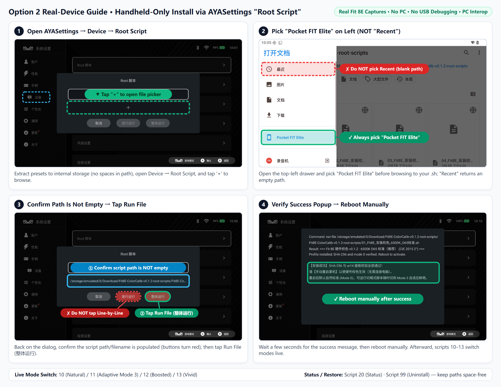

**This project was built by GPT6.2 Astra and Gemini4 Neon.**

# Fit 8E Display Calibration

Install a native Qualcomm SM8750P QDCM hardware color profile on the **KONKR Pocket FIT Elite (Fit 8E)** internal display to eliminate factory oversaturation and white-point green tint. Supports both the desktop USB tool and PC-free on-device installation via AYASettings "Root Script". Current version **0.1.2**. [简体中文](README.md) · [Changelog](CHANGELOG.md) · [Project](https://github.com/lx081081/Fit8E-ColorCalib)

The application code is licensed under the GNU General Public License, version 3 only. [License](LICENSE) · [Third-party notices](THIRD_PARTY_NOTICES.md)

## Important Notes

- **Only for the Snapdragon 8 Elite Fit 8E with its `ar14` internal panel.** If the tool reports "Panel unconfirmed", verify your panel model before selecting manual confirmation. Do not install on the Fit 8G3 or other handhelds.
- **Save your game before installing or uninstalling.** The Windows tool reboots the handheld by default after applying changes, while handheld Root Scripts prompt you to reboot manually. Keep any custom JSON used with a legacy installer so the tool can verify it during removal.
- This is an open-source community tool; modifying display configuration is at your own risk. The built-in reference profile was measured on one unit, and individual panels can vary slightly.

## Features

- **Native hardware calibration with zero overhead**: Writes directly to the SM8750P QDCM V3 hardware pipeline (3D LUT + IGC/GC) — zero root required on PC, no system partition edits, OTA-safe, and automatically backs up your pre-install state for one-click rollback.
- **CIE 2015 2° white point & tint tuning**: Offers a **5500–7500 K** continuous slider, **6000 / 6500 / 6800 / 7100 K** quick presets, and **-10..+10** green/magenta tint control computed under the CIE 2015 2° observer. Selecting a preset resets tint to zero, while dragging the temperature slider keeps your current tint.
- **Measured D65 reference & flexible output**: **6500 K with tint 0** uses the exact optically measured and verified D65 profile. Any other CCT/tint synthesizes new hardware tables for **direct USB installation**, **JSON export**, or **single-file AYASettings Root Script (`.sh`) export**. Loading a custom JSON preserves its embedded white point and locks both sliders (Root Script export remains available).
- **Four live hardware color modes (no reboot required)**:
  - **Natural (Mode 0, Recommended)**: Automatically switches between accurate sRGB, Display P3, and HDR10 PQ by content with zero artificial saturation boost.
  - **Boosted (Mode 1)**: Applies Android's mild native saturation boost on top of the calibrated sRGB baseline.
  - **Vivid (Mode 2)**: Uses the panel's native wide gamut while preserving the calibrated white point and grayscale.
  - **Adaptive (Mode 3)**: Smoothly expands sRGB vibrancy (~125% sRGB) in OKLab with skin-tone protection under the CIE 2015 2° white point while keeping automatic Display P3 and HDR10 management active.

## Usage

### Option 1: PC via USB (Recommended for custom white points & live preview)

1. Download and extract the complete `Fit8E-ColorCalib-v0.1.2-win64.zip` from the [releases page](https://github.com/lx081081/Fit8E-ColorCalib/releases) and launch `Fit8E-ColorCalib.exe` (ADB, the default profile, and preset handheld Root Scripts are all bundled).
2. Enable **USB debugging** under Developer options on the handheld, connect a USB data cable, allow debugging, then click **Refresh** in the tool and confirm `Pocket FIT Elite`.
3. For first-time setup, keep the measured default **6500 K, tint 0** and choose **Install Calibration & Reboot** (or **Install Only** to reboot later).
4. Unlock the handheld after reboot and click **Refresh** to verify activation. If Windows loses the USB device, reconnect the cable and choose File transfer. Legacy installs without a boot record appear as **Activation Unconfirmed**.
5. Choose **Uninstall & Restore** to restore your pre-install profile and display mode (recognizes legacy 0.1.0 / 0.1.1 built-in 6500 K profiles). After a busy or timeout notice, wait for the operation to finish and refresh before retrying.

### Option 2: Handheld-only via AYASettings "Root Script" (No PC required)

No PC, USB debugging, or Shizuku is needed. Run a self-contained `.sh` script directly inside **AYASettings → Device → Root Script** with full device/`ar14` panel checks, SHA-256 verification, factory backup, and SELinux labeling — fully interoperable with the desktop app:

1. Download the standalone `Fit8E-ColorCalib-v0.1.2-root-scripts.zip` from the [releases page](https://github.com/lx081081/Fit8E-ColorCalib/releases) (also bundled under `root-scripts/` in the Windows portable ZIP) and extract it to internal storage such as `/sdcard/Download/Fit8E/` (**do not put spaces in the folder path or filename**).
2. Open **AYASettings → Device (设备) → Root Script (Root 脚本)** on the handheld and tap **`+`** to open the system file picker.
3. **Open the left sidebar and pick `Pocket FIT Elite` (do NOT pick "Recent / 最近")**: Fit 8E's system file picker returns an unresolved empty path if you pick a file from **Recent**. Tap the top-left menu icon, select **`Pocket FIT Elite`** in the sidebar, and navigate to your extracted folder to pick a preset install script:
   - `01_Fit8E_安装校色_6500K_D65标准.sh` (Measured CIE 2015 2° D65 reference, recommended)
   - `02_Fit8E_安装校色_6000K_暖色.sh` (6000 K warm daylight)
   - `03_Fit8E_安装校色_6800K_微冷.sh` (6800 K crisp white)
   - `04_Fit8E_安装校色_7100K_冷白.sh` (7100 K cool white)
4. **Confirm the filename/path field is NOT empty, then tap Run File (整体运行)**: back on the Root Script dialog, verify that the center box shows the script path/filename (and the bottom run buttons turn active red). Tap **Run File (整体运行)** — **NOT** Run Line-by-Line (逐行运行); tapping line-by-line prints a reminder and exits safely without touching the display config. After the success popup appears, **reboot the handheld manually**.
5. Once activated after reboot, follow the same steps to run any mode script via **Run File (整体运行)** and switch modes live without rebooting:
   - `10_Fit8E_切换模式0_自然标准.sh` · `11_Fit8E_切换模式3_自适应鲜艳.sh` · `12_Fit8E_切换模式1_增强模式.sh` · `13_Fit8E_切换模式2_鲜艳模式.sh`
6. Use `20_Fit8E_查看当前状态.sh` to inspect status read-only, or `99_Fit8E_卸载还原原厂.sh` to restore the original factory profile and mode (then **reboot manually**).
7. For custom 5500–7500 K CCT, green/magenta tint, or a custom JSON, click **Export Root .sh** in the desktop GUI (or use the CLI `export-script` command) to create a `< 250 KB` standalone `.sh` well under AYASettings' 1 MiB file limit.

### Optional Companion App: [Fit Palette (Fit 调色盘)](https://github.com/lx081081/Fit-Palette) for Live On-Device Tuning

Once the base QDCM calibration from this tool is installed, if you want **zero-reboot, PC-free live tuning** and 1-tap mode switching directly on the handheld, pair it with the lightweight open-source Android companion **[Fit Palette](https://github.com/lx081081/Fit-Palette)** (~50 KB, no internet permission, works out of the box on Fit 8E):

- **Designed to pair together**: Fit8E-ColorCalib establishes the underlying QDCM hardware calibration (fixing gamut oversaturation, green tint, grayscale gamma, and HDR10 tone mapping); **Fit Palette** layers live hardware adjustments on top via Qualcomm DPU PCC (`SurfaceFlinger 1015 / 1022`) with no reboot required.
- **Live tuning & 1-tap mode switching**: Adjust **5000–8500 K** CIE 2015 2° white point, **-10..+10** tint, per-channel **RGB gains**, and **0%–150% saturation** in real time, and switch directly between all four hardware color modes (`Natural` / `Boosted` / `Vivid` / `Adaptive`) without reopening AYASettings — plus optional restore-on-boot.
- **Download**: Grab the APK from the [Fit-Palette releases page](https://github.com/lx081081/Fit-Palette/releases); it automatically detects your Fit8E-ColorCalib activation state on launch.

macOS, Linux, CLI and Shizuku

- **macOS / Linux**: Requires Python 3.9+ and ADB. Run `python3 src/fit8e_color_tool.py status` in the source directory; once `Target Match` is `True`, run `python3 src/fit8e_color_tool.py install` to install the default profile.
- **Custom JSON export & measurement compilation**: Run `python3 src/fit8e_color_tool.py export --cct 6800 --tint 0 --out fit8e-6800.json`. For your own conventional 1931 RGB/XYZ ArgyllCMS `.ti3` measurements, use `src/build_qdcm_v3.py` to compile a custom profile.
- **CLI Root Script export**: Run `python3 src/fit8e_color_tool.py export-script --cct 6800 --tint -1 --out Fit8E_6800K.sh` (also supports `--json <custom.json>`, `--action mode --mode 3`, `--action status`, and `--action uninstall`), or generate the full preset pack via `python3 src/fit8e_color_tool.py export-presets --out-dir ./root-scripts`.
- **Shizuku**: Copy `scripts/fit8e_calib_shizuku.sh` and the default JSON from `assets/` to `/sdcard/Download/`, run `sh /sdcard/Download/fit8e_calib_shizuku.sh install` in a Shizuku-authorized shell, then reboot manually.

## How It Works & Measurements

The temperature setting is the nominal CIE D-series daylight temperature. The tool integrates the daylight basis spectra against the CIE 2015 2° color matching functions at 1 nm intervals, anchoring 6500 K to the tabulated D65 spectrum, and applies tint perpendicular to the daylight locus in uniform chromaticity coordinates. Two 105-patch factory captures relate the sRGB and Display P3 primaries to the measured panel, and measured gray ramps determine the hardware tone curves. [CIE daylight basis](https://doi.org/10.25039/CIE.DS.w7zunnny) · [CIE 2015 2° observer](https://doi.org/10.25039/CIE.DS.548rw69q)

Natural mode was verified with 51 SDR patches at system brightness 102/255 using an X-Rite i1Display3 with Panasonic PFS spectral correction:

| Metric | Factory | 0.1.2 default (Mode 0) |
|---|---:|---:|
| White-point distance to 2015 D65, Δu′v′ | 0.00955 | 0.00022 |
| Mean gray distance at 20–100%, Δu′v′ | 0.00685 | 0.00055 |
| White luminance at the same setting, cd/m² | 211.96 | 191.20 |

Five repeat white readings averaged **(0.31345, 0.33072)** against the D65 target **(0.31345, 0.33080)**. A 1931 2° cross-check against the white-adapted sRGB reference gave mean **ΔE00 0.45** and maximum **1.12** (Mode 0's sRGB hardware table in 0.1.2 is identical to the 0.1.1 verified profile; the new Mode 3 Adaptive Vibrant shares a bit-identical neutral gray diagonal with Mode 0 and expands sRGB gamut smoothly to ~125% in OKLab with skin-tone protection). Other temperatures are model predictions. The HDR10 PQ curve uses the project parameters of 280 nits knee, 447 nits target peak, and 0.37 nits black. The archived optical verification dataset covers Natural-mode SDR sRGB. [Measurement results](assets/measurements/verification.json)
